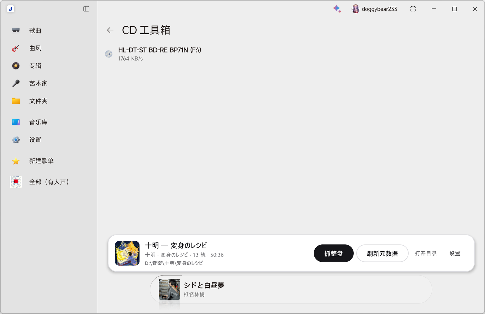
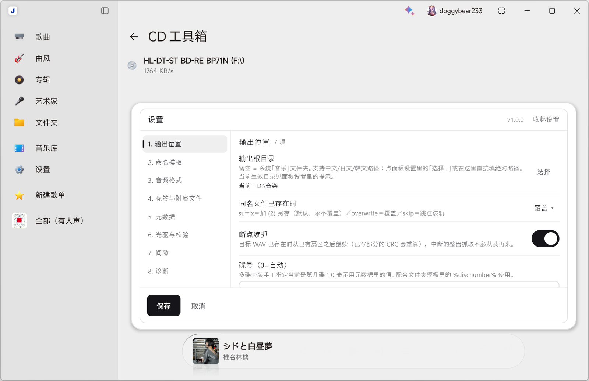

<p align="center">
  
</p>

<h1 align="center">盐专辑 · Salt Audio Copy</h1>

<p align="center">给 Salt Player for Windows 的 CD 抓轨 Mod：在「CD 工具箱」里整盘抓轨，按 EAC 的思路做安全校验，自动补元数据与封面。</p>

<p align="center">
  <a href="https://github.com/doggybear233/Salt-Audio-Copy/releases/latest"></a>
  <a href="https://steamcommunity.com/sharedfiles/filedetails/?id=3823853865"></a>
  <a href="#系统要求"></a>
  <a href="LICENSE"></a>
</p>

一个 `.spmod` 插件：装上后宿主「CD 工具箱」页面底部会出现抓轨坞，直接抓整盘，写逐轨 WAV / FLAC、整盘镜像 + CUE、EAC 兼容日志，并从 MusicBrainz / gnudb / Cover Art Archive 补全元数据与封面。

> A secure CD-ripping mod for Salt Player for Windows. SPTI/MMC raw reads, re-read verification, CUE + EAC-compatible log, MusicBrainz / gnudb / Cover Art Archive metadata, and a bundled FLAC 1.4.3 encoder. UI in 简体中文 / English / 日本語.

## 功能

- **安全抓轨**：SPTI/MMC 原始读；每块最多重读到 82 次；恢复档 low / medium / high 分别要求连续 **1 / 2 / 5** 次结果一致；C2 错误指针、缓存绕过、精确流偏移、Test & Copy。
- **三种输出**：逐轨 WAV、逐轨 FLAC、整盘镜像 + CUE；断点续抓；同名文件可选「另存 / 覆盖 / 跳过」。
- **校验与记录**：每轨 CRC32、峰值电平、Track Quality；EAC 兼容日志（TOC、设置摘要、逐轨结果）。
- **间隙处理**：子通道 Q 与静音扫描两种探测；并入上一轨 / 修正 / 留空三种处理；可抓轨前预扫。
- **元数据**：MusicBrainz DiscID、gnudb CDDB（本地缓存与镜像回落）、Cover Art Archive、CD-TEXT 预填。
- **手填与封面**：整张 / 逐轨歌名、艺术家、年份、碟号；导入本地封面（jpg / png / webp / bmp / gif），保存后立即生效。
- **内置编码器**：随包 FLAC 1.4.3，不需要自己找 `flac.exe`。
- **三语界面**：简体中文 / English / 日本語；46 个设置键与 15 个按钮全部跟随语言。

## 界面

抓轨坞跟随宿主深浅色，宽度铺满「CD 工具箱」底部：


设置面板是面板内的二级导航，共 8 组（左列分类 + 右侧条目）：



深色版本见 [`docs/screenshots/dock-dark.png`](docs/screenshots/dock-dark.png) 与 [`docs/screenshots/settings-dark.png`](docs/screenshots/settings-dark.png)。

## 安装

需要 Salt Player for Windows（Steam 或 Microsoft Store 版，需支持创意工坊插件）。

**方式一：GitHub 下载**

1. 到 [Releases](https://github.com/doggybear233/Salt-Audio-Copy/releases/latest) 下载 `plugin-com.doggybear233.saltaudiocopy-1.0.0.spmod`。
2. 打开 Salt Player →「模组管理」→ 导入该文件 → 启用。
3. 权限里勾上 **class-transform**（面板挂载需要它；缺了面板不会出现）。
4. 进入「CD 工具箱」，页面底部出现抓轨坞。

**方式二：Steam 创意工坊**

在 [Steam 创意工坊条目](https://steamcommunity.com/sharedfiles/filedetails/?id=3823853865) 订阅本 Mod。订阅后仍需在「模组管理」里手动启用并确认权限（宿主的 Steam 订阅默认不自动启用）。本地导入的同一 Plugin-Id 与工坊订阅同时存在时，两份会被同时停用，只保留一份即可。

**权限用途**：本插件只申请 `class-transform`，用于在「CD 工具箱」页面挂载抓轨坞并注册面板入口；不读取曲库、不注册快捷键、不联网上传音频。

## 设置

面板内 8 组 / 46 个设置键 / 15 个按钮：输出位置、命名模板、音频格式、标签与附属文件、元数据、光驱与校验、间隙、诊断。逐项说明见 [docs/options-table.md](docs/options-table.md)。

## 系统要求

| 项目 | 要求 |
|---|---|
| 操作系统 | Windows 10 / 11 x64 |
| 宿主 | Salt Player for Windows，支持创意工坊插件（Workshop API 0.1.0-dev22 构建） |
| 硬件 | CD/DVD 光驱（SPTI 访问；不需要额外驱动） |
| 从源码构建 | JDK 25（`jvmToolchain(25)`） |

## 从源码构建

仓库自带 Gradle wrapper，不必预装 Gradle：

```powershell
cd mod
.\gradlew.bat clean test plugin    # 跑单元测试并产出 .spmod
# 产物：mod\build\libs\plugin-com.doggybear233.saltaudiocopy-<版本>.spmod
```

- 默认套件 627 个用例；真机 / 联网用例单独跑：`.\gradlew.bat liveTest`（13 个，按硬件与网络条件自动跳过不满足的项）。
- 真机验收清单：[docs/manual-test-checklist.md](docs/manual-test-checklist.md)。
- `dev-env.ps1` 只是作者机器上的可选脚本（设置 `JAVA_HOME` / `GRADLE_HOME`），普通构建不需要。

## 已知限制

- **AccurateRip 未实现**：其协议与数据库为第三方资产，本插件只做本地重读与 Test & Copy 比对。
- **WAV 的 `LIST/INFO` 标签只能存 ANSI**：资源管理器里中日韩会显示成 `?`；音频数据与 ID3v2 通道不受影响，FLAC 也不受影响。
- **gnudb 在国内常被屏蔽**：主通道是 MusicBrainz，不通用手填或代理。
- **宿主「模组管理」页固定中文**：宿主渲染单份配置 JSON，插件无法按语言切换；面板内的设置页是完整本地化版本。

## 目录

```
mod/                       插件源码（Kotlin / Compose）
mod/src/main/kotlin/...    scsi/ 设备与命令、rip/ 读取与校验、album/ 流程、meta/ 元数据、ui/ 面板
docs/screenshots/          真机截图
docs/options-table.md      配置项说明表
docs/manual-test-checklist.md  手动验收清单
docs/                      其余设计、需求与评审文档
design/                    设计稿、审查报告、文案复查
release/                   发布物料（GitHub / Steam 两份，本地产物、不入库）
```

## 第三方组件与合规

- **独立实现**：本项目的抓轨流程与参数参考了对 Exact Audio Copy 1.8 的行为分析，但**不包含** EAC 的任何代码、二进制、图标或文本，也与 EAC 官方无隶属关系；EAC 是其权利人的商标。
- **内置 FLAC**：`mod/src/main/resources/native/win64/` 下的 `flac.exe` 为 FLAC 1.4.3（**GPL-2.0-or-later**），`libFLAC.dll` / `libFLAC++.dll` 为 **BSD-3-Clause**。MIT 只覆盖本项目原创代码，不覆盖这些第三方二进制。GPL 全文（随包 `native/win64/COPYING.GPL`）、版权声明与对应源码获取地址见 [THIRD-PARTY-NOTICES.md](THIRD-PARTY-NOTICES.md)，发布包内 `META-INF/` 也带同一份声明。
- **光盘内容**：请仅在你拥有合法复制权、并遵守当地法律与你所持光盘许可的前提下使用；本插件不绕过任何复制保护或 DRM。
- **第三方服务**：MusicBrainz、Cover Art Archive、gnudb 由各自提供方运营，可用性与条款随其变化；插件只发送光盘 TOC / 曲目查询，不上传音频。
- **日志**：运行日志写在插件数据目录的 `logs/saltaudiocopy.log`，可能包含光盘路径与曲目名；导出诊断信息前请自行检查。

## 许可

本项目原创代码以 **MIT** 许可发布，见 [LICENSE](LICENSE)。随包分发的 FLAC 二进制为 GPL-2.0-or-later / BSD-3-Clause，见 [THIRD-PARTY-NOTICES.md](THIRD-PARTY-NOTICES.md)。

## 致谢

- [Xiph.Org Foundation](https://xiph.org/flac/)：FLAC 1.4.3 编码器与 `libFLAC`。
- [MusicBrainz](https://musicbrainz.org/)、[gnudb](https://www.gnudb.org/)、[Cover Art Archive](https://coverartarchive.org/)：元数据与封面来源。
- [Exact Audio Copy](https://www.exactaudiocopy.de/)：抓轨行为与日志格式的参考对象（无代码关系）。
- [Salt Player for Windows](https://saltplayer.com/) 与 Workshop API：宿主与插件接口。
