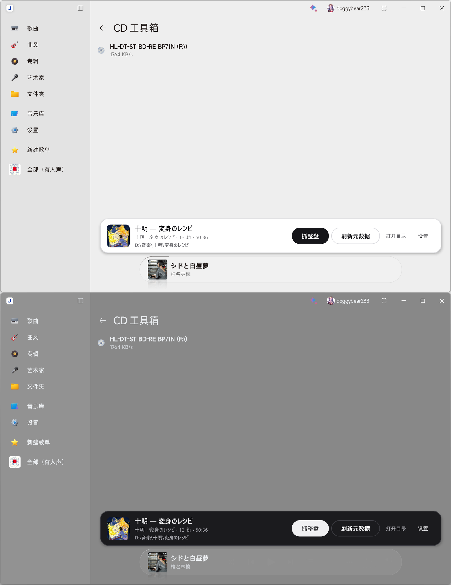
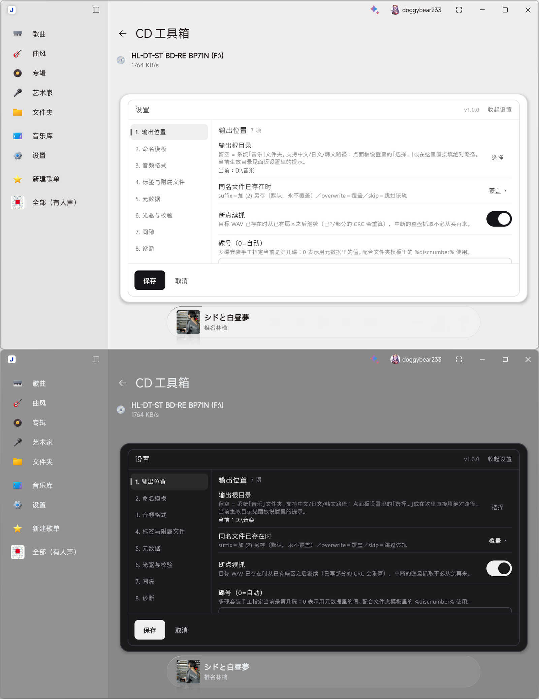

# 盐专辑 · Salt Audio Copy

一个给 **Salt Player for Windows** 用的 CD 抓轨 Mod（`.spmod` 插件）：在宿主「CD 工具箱」页面里直接抓整盘，按 EAC 的思路做安全校验、写 CUE 与日志、自动补全元数据与封面。

- **平台**：Windows 10 / 11（x64）
- **宿主**：Salt Player for Windows（需支持 Workshop 插件）
- **语言**：简体中文 / English / 日本語
- **许可**：插件本体 MIT；内置 FLAC 1.4.3 为 GPL-2.0-or-later（见 [THIRD-PARTY-NOTICES.md](THIRD-PARTY-NOTICES.md)）

> A secure CD-ripping plugin for Salt Player for Windows: SPTI/MMC raw reads, re-read verification, CUE + EAC-compatible log, MusicBrainz / gnudb / Cover Art Archive metadata, FLAC via a bundled Xiph 1.4.3 encoder, fully localized UI (zh / en / ja).

## 安装

1. 从 [Releases](https://github.com/doggybear233/Salt-Audio-Copy/releases) 下载 `plugin-com.doggybear233.saltaudiocopy-1.0.0.spmod`。
2. 打开 Salt Player →「模组管理」→ 导入该文件 → 启用。
3. 权限里勾上 **class-transform**（面板挂载需要它；缺了面板不会出现）。
4. 进入「CD 工具箱」，页面底部出现抓轨坞；点「设置」可改输出目录、命名模板、格式等。

## 功能

| 分类 | 内容 |
|---|---|
| 安全抓轨 | 每块最多 16 次重读；出错恢复三档 low / medium / high 分别要求连续 **1 / 2 / 5** 次一致；C2 错误指针；驱动器缓存绕过；精确流偏移校正 |
| 输出 | 逐轨 WAV、逐轨 FLAC、整盘镜像 + CUE；断点续抓；同名文件「另存 / 覆盖 / 跳过」 |
| 校验与记录 | 每轨 CRC32、峰值电平、Track Quality；EAC 兼容日志（含 TOC、设置摘要）；可选 Test & Copy |
| 间隙 | 子通道 Q / 静音扫描两种探测；间隙「并入上一轨 / 修正 / 留空」三种处理；抓轨前预扫 |
| 元数据 | MusicBrainz DiscID、gnudb CDDB（带本地缓存与镜像回落）、Cover Art Archive、CD-TEXT 预填 |
| 手填 | 整张专辑 / 逐轨歌名 / 该轨艺术家 / 年份 / 碟号；导入本地封面（jpg/png/webp/bmp/gif）；保存后立刻生效 |
| 诊断 | 环境自检（语言 / 代码页 / CJK 路径）、网络自检（MusicBrainz / Cover Art / CDDB）、读命令矩阵、日志文件夹 |

## 抓轨坞长什么样



设置面板（面板内二级导航，8 页）：



## 从源码构建

需要 **JDK 25**（`mod/build.gradle.kts` 里是 `jvmToolchain(25)`）。仓库自带 Gradle wrapper，不必预装 Gradle：

```powershell
cd mod
.\gradlew.bat clean test plugin    # 跑单元测试并产出 .spmod
# 产物：mod\build\libs\plugin-com.doggybear233.saltaudiocopy-<版本>.spmod
```

- `dev-env.ps1` 是可选的本地脚本（作者机器上的 JDK / Gradle 路径）：它只校验 `JAVA_HOME` 指向的 `bin\java.exe` 是否存在，缺失就报错退出；普通构建不需要它，只要 PATH 上能用到 JDK 25。
- 单元测试 551 项（默认套件）；另有 13 项真机/联网用例（`live` 标签），跑 `.\gradlew.bat liveTest`。
- 真机测试清单：`manual-test-checklist.md`。

## 目录

```
mod/                       插件源码（Kotlin / Compose）
mod/src/main/kotlin/...    scsi/ 设备与命令、rip/ 读取与校验、album/ 流程、meta/ 元数据、ui/ 面板
design/                    设计稿、审查报告、文案复查
manual-test-checklist.md   手动验收清单
options-table.md           配置项统计表
release/                   发布物料（GitHub / Steam 两份，本地产物、不入库）
```

## 已知限制

- **AccurateRip 未实现**：协议私有，只做本地重读与 Test & Copy 比对。
- **WAV 的 `LIST/INFO` 标签只能存 ANSI**：资源管理器里中日韩会变 `?`；音频与 ID3v2 通道正确，FLAC 不受影响。
- **gnudb 在国内常被屏蔽**：主通道是 MusicBrainz，不通用手填或填代理。
- **宿主「模组管理」页固定中文**：宿主渲染单份配置 JSON，插件无法按语言切换；面板内的设置页是完整本地化版本。

## 许可

插件本体 MIT，见 [LICENSE](LICENSE)。随包的内置 FLAC 编码器（`flac.exe` 1.4.3）为 GPL-2.0-or-later，`libFLAC` / `libFLAC++` 为 BSD-3-Clause，来源、校验值与源码获取方式见 [THIRD-PARTY-NOTICES.md](THIRD-PARTY-NOTICES.md)。
